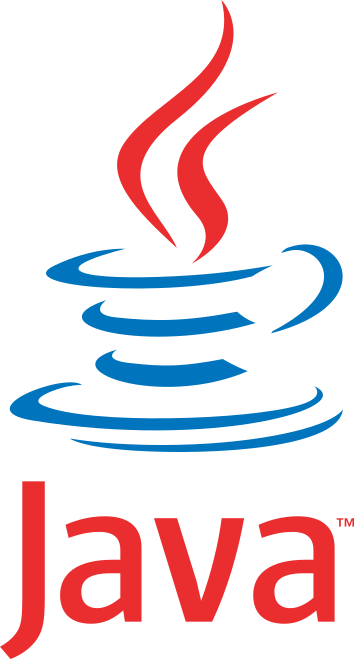
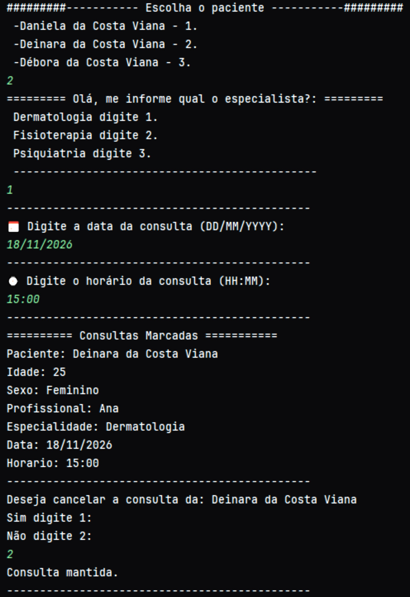

  

# 💛 Sistema de Agendamento

  <strong> Sistema de gerenciamento de consultas desenvolvido em Java.</strong>

---

## 🟡 Tecnologias utilizadas

- ☕ Java
- Programação Orientada a Objetos (POO)
- ArrayList
- LocalDateTime

---

## 🟡 Funcionalidades

- Cadastro e escolha de pacientes
- Escolha de profissionais
- Agendamento de consultas
- Validação de datas e horários
- Prevenção de agendamentos duplicados
- Cancelamento de consultas

---

## 🖥️ Demonstração

  

---

## 👩‍💻 Autora

Desenvolvido por **Débora**.

